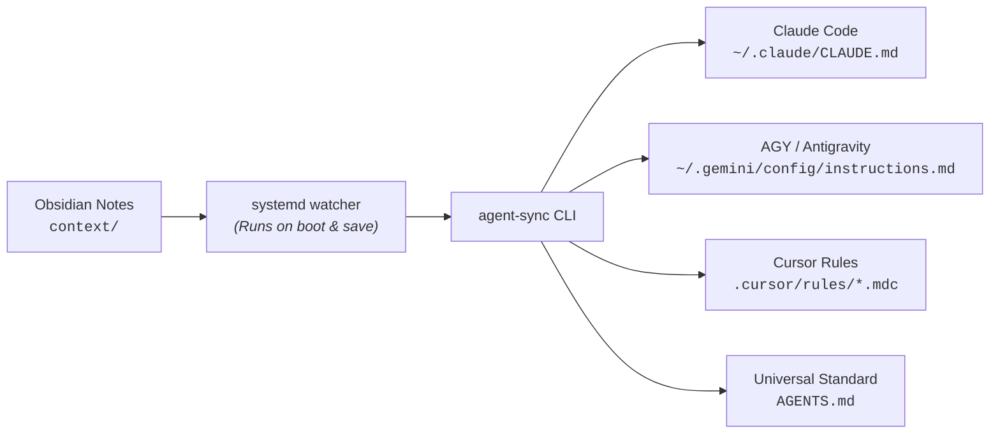

# Agent Context Hub

> **Single Source of Truth (SSOT) Developer Context for AI Coding Agents**  
> Supports: **AGY (Antigravity CLI)**, **Claude Code**, **Cursor**, **Windsurf**, **OpenCode / Codex**, and **AGENTS.md**.

---

## Overview

When using multiple AI coding agents, you constantly have to re-explain who you are, your seniority, your preferred tools, and negative constraints ("never use `any`", "vitest over jest", "terse replies"). 

`agent-context-hub` solves this by establishing a **Pragmatic Hybrid Architecture**:
1. **Author in Obsidian:** Maintain your developer identity, rules, and technology playbooks as standard Markdown notes in an Obsidian vault (`context/`).
2. **Ahead-of-Time (AOT) Sync:** The `agent-sync` CLI compiles these notes into lightweight, tool-native formats (`~/.claude/CLAUDE.md`, `~/.gemini/config/instructions.md`, `.cursor/rules/*.mdc`, and `AGENTS.md`).
3. **Background Daemon:** A Linux `systemd` user watcher automatically triggers sync on boot and every time you save a note in Obsidian.
4. **Deep Knowledge on Demand:** Deep architecture notes (ADRs) are accessed on-demand via a sandboxed Model Context Protocol (MCP) server without prompt bloat.



---

## Directory Structure

```
agent-context-hub/
├── bin/
│   └── agent-sync.py             # Compiler CLI
├── context/                      # Obsidian Vault directory (Source of Truth)
│   ├── global/
│   │   ├── identity.md           # Seniority, persona, communication axioms
│   │   └── guardrails.md         # Strict negatives, security, git hygiene
│   ├── stacks/                   # Technology-specific rules (glob-scoped)
│   │   ├── typescript-react.md
│   │   ├── python-backend.md
│   │   └── linux-hyprland.md
│   └── adrs/                     # Deep Architecture Decision Records (MCP query)
│       └── 001-architecture-template.md
├── systemd/
│   ├── agent-sync.service        # Oneshot sync service
│   └── agent-sync.path           # Inotify path watcher
├── install.sh                    # Automated setup script
├── uninstall.sh                  # Clean removal script
└── README.md
```

---

## Quickstart Installation

Run the installation script:

```bash
cd ~/workspace/agent-context-hub
./install.sh
```

What `install.sh` does:
1. Installs `agent-sync` CLI into `~/.local/bin/agent-sync`.
2. Creates an Obsidian convenience link at `~/Vault/Context -> ~/workspace/agent-context-hub/context`.
3. Installs and enables the `systemd` user watcher (`agent-sync.path`).
4. Enables `loginctl enable-linger` so the daemon automatically runs upon machine boot/restart.
5. Performs the initial compilation of global instructions.

---

## How It Works with Obsidian (Zero-Configuration Setup)

The `context/` directory in this repository **is** your Obsidian vault. You don't have to navigate folders or configure paths manually:

1. **Launch Obsidian** (from your application launcher or by running `obsidian` in terminal).
2. The vault opens automatically with your context files in the sidebar:
   * **`global/identity.md`**: Your bio, seniority, engineering philosophy, and communication tone.
   * **`global/guardrails.md`**: Strict "never-do" negative constraints and security invariants.
   * **`stacks/`**: Technology-specific rules (TypeScript, Python, Linux) that trigger conditionally based on file extensions.
   * **`adrs/`**: Deep architecture notes and decisions accessible on-demand via MCP.
3. **Edit in plain English and save (`Ctrl+S`).**
4. The background `systemd` watcher immediately compiles and propagates changes to AGY, Claude Code, Cursor, and OpenCode in milliseconds.

---

## Daily Usage

### 2. Checking Health & Token Budget
Run:
```bash
agent-sync --status
```
Example output:
```
============================================================
 AGENT CONTEXT HUB: STATUS & HEALTH CHECK
============================================================
Active Context Directory: /home/akshay/workspace/agent-context-hub/context
Context Directory Exists: True

Global Modules (2):
  - guardrails.md             (~  82 tokens)
  - identity.md               (~  84 tokens)
  Total Estimated Global Tokens: ~166 (Target: < 500)

Stack Playbooks (3):
  - linux-hyprland.md         (globs: **/*.{conf,sh,qml,cpp})
  - python-backend.md         (globs: **/*.py)
  - typescript-react.md       (globs: **/*.{ts,tsx,jsx})

Daemon / Watcher Status:
  systemd path unit (agent-sync.path): ACTIVE
  Linger (boot persistence): Linger=yes
============================================================
```

### 3. Setting Up a Workspace / Project
To generate project-specific rules (`AGENTS.md`, `CLAUDE.md`, and `.cursor/rules/*.mdc`) inside a repository:

```bash
agent-sync --workspace ~/workspace/my-project
```

---

## Pushing to GitHub

To store and sync this repository with your GitHub account:

```bash
cd ~/workspace/agent-context-hub

# Create a new repository on GitHub (using GitHub CLI)
gh repo create agent-context-hub --public --source=. --remote=origin --push

# Or push to an existing remote:
# git remote add origin git@github.com:<your-username>/agent-context-hub.git
# git branch -M master
# git push -u origin master
```

---

## License

MIT License
